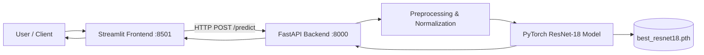

# 👤 Face Gender Classification with PyTorch & ResNet-18

[](https://www.python.org/)
[](https://pytorch.org/)
[](https://fastapi.tiangolo.com/)
[](https://streamlit.io/)
[](LICENSE)

An end-to-end deep learning project for binary gender classification (Male / Female) from facial images. Powered by transfer learning with **ResNet-18**, served via a high-performance **FastAPI** backend, and presented through an interactive **Streamlit** web user interface.

---

## 📑 Table of Contents

- [Overview](#-overview)
- [Key Features](#-key-features)
- [Project Architecture](#-project-architecture)
- [Directory Structure](#-directory-structure)
- [Dataset Setup](#-dataset-setup)
- [Installation & Environment Setup](#-installation--environment-setup)
- [Model Training & Evaluation](#-model-training--evaluation)
- [Serving & Web UI](#-serving--web-ui)
  - [1. Running the FastAPI Backend](#1-running-the-fastapi-backend)
  - [2. Running the Streamlit Frontend](#2-running-the-streamlit-frontend)
- [API Documentation](#-api-documentation)
- [Model Details & Preprocessing](#-model-details--preprocessing)
- [Running Tests](#-running-tests)
- [Future Improvements](#-future-improvements)

---

## 🌟 Overview

This project provides a complete machine learning pipeline:
1. **Data Preprocessing & Augmentation**: Color jittering, random rotations, flips, and ImageNet standardization.
2. **Transfer Learning**: Pretrained ResNet-18 backbone with a custom linear classification head.
3. **Training & Validation**: Stratified train/val splits, AdamW optimizer, loss tracking, and automated checkpointing of the best weights.
4. **Model Evaluation**: Metrics tracking including Test Accuracy, Precision, Recall, F1-Score, and Confusion Matrix.
5. **Deployment Ready**:
   - **REST API** using FastAPI for real-time inference.
   - **Interactive Web App** using Streamlit for instant image uploads and confidence score visualization.

---

## ✨ Key Features

- **Transfer Learning Backbone**: Leverages ImageNet weights from ResNet-18 to achieve high performance with fast convergence.
- **Hardware Agnostic**: Seamlessly runs on **CUDA (NVIDIA GPUs)**, **Intel XPU**, or **CPU** with automatic fallback.
- **Robust Data Pipeline**: Data augmentation with `torchvision.transforms` to prevent overfitting on facial variations.
- **Interactive UI**: Clean Streamlit dashboard displaying prediction results and model confidence percentages.
- **Fast REST API**: Asynchronous image processing with automated Swagger / OpenAPI documentation.

---

## 🏗 Project Architecture



---

## 📁 Directory Structure

```text
Gender Classification/
├── api/
│   └── main.py                 # FastAPI application routes (/health, /predict)
├── best_model/
│   └── best_resnet18.pth       # Trained model checkpoint weights
├── dataset/
│   ├── gender_detection.csv    # Metadata / labels dataset (optional)
│   ├── train/
│   │   ├── men/                # Training images for male class
│   │   └── women/              # Training images for female class
│   └── test/
│       ├── men/                # Test images for male class
│       └── women/              # Test images for female class
├── notebooks/
│   └── eda.ipynb               # Exploratory Data Analysis & visual inspections
├── src/
│   ├── __init__.py
│   ├── dataloader.py           # PyTorch DataLoader factory
│   ├── dataset.py              # Dataset loading & stratified train/val split
│   ├── evaluate.py             # Evaluation script (Accuracy, F1, Confusion Matrix)
│   ├── model.py                # ResNet-18 model architecture definition
│   ├── predict.py              # Standalone inference helper functions
│   ├── preprocessing.py        # Training and inference image transform pipelines
│   └── train.py                # Training loop with epoch validation & checkpointing
├── tests/
│   ├── __init__.py
│   └── test_model.py           # Model forward pass and shape verification
├── streamlit_app.py            # Streamlit interactive web dashboard
├── requirements.txt            # Python dependencies
└── README.md                   # Project documentation
```

---

## 📊 Dataset Setup

The project expects an image dataset categorized into directory folders by class:

```text
dataset/
├── train/
│   ├── men/     <-- .jpg / .png images
│   └── women/   <-- .jpg / .png images
└── test/
    ├── men/     <-- .jpg / .png images
    └── women/   <-- .jpg / .png images
```

- Images are automatically resized to **224 × 224** pixels.
- The training process automatically splits `dataset/train` into **80% training** and **20% validation** using stratified sampling.

---

## 🚀 Installation & Environment Setup

### 1. Prerequisites
- **Python**: 3.10 or higher recommended.
- (Optional) NVIDIA GPU with CUDA drivers installed for GPU acceleration.

### 2. Clone / Open the Repository
```bash
git clone https://github.com/your-username/gender-classification.git
cd "Gender Classification"
```

### 3. Create and Activate a Virtual Environment
```bash
# Windows (PowerShell)
python -m venv venv
.\venv\Scripts\Activate.ps1

# Windows (Command Prompt)
.\venv\Scripts\activate.bat

# Linux / macOS
python3 -m venv venv
source venv/bin/activate
```

### 4. Install Dependencies
```bash
pip install --upgrade pip
pip install -r requirements.txt
```

---

## 🧠 Model Training & Evaluation

### Train the Model
Run the training script to train the model head, monitor train/val losses, and save the best performing checkpoint to `best_model/best_resnet18.pth`:

```bash
python -m src.train
```

**Training Hyperparameters:**
- **Epochs**: `15`
- **Batch Size**: `16`
- **Learning Rate**: `0.001` (with `AdamW` and weight decay `1e-4`)
- **Loss Function**: `CrossEntropyLoss`

### Evaluate the Model
Evaluate the saved checkpoint against the unseen test dataset:

```bash
python -m src.evaluate
```

This outputs:
- **Test Accuracy Score**
- **Classification Report**: Precision, Recall, F1-Score for each class
- **Confusion Matrix**

---

## 🌐 Serving & Web UI

### 1. Running the FastAPI Backend
Start the inference REST API using Uvicorn:

```bash
uvicorn api.main:app --host 127.0.0.1 --port 8000 --reload
```

- API Base URL: `http://127.0.0.1:8000`
- Interactive Swagger UI: `http://127.0.0.1:8000/docs`
- ReDoc UI: `http://127.0.0.1:8000/redoc`

### 2. Running the Streamlit Frontend
In a new terminal window (with your virtual environment activated), start the Streamlit interface:

```bash
streamlit run streamlit_app.py
```

Streamlit will launch locally at `http://localhost:8501`. You can upload any face image (`.jpg`, `.jpeg`, `.png`) to inspect predictions and model confidence.

---

## 🔌 API Documentation

### Endpoints

| Method | Endpoint | Description | Response Example |
|---|---|---|---|
| `GET` | `/` | API status check | `{"message": "Face Gender Classification API is running"}` |
| `GET` | `/health` | Healthcheck endpoint | `{"status": "healthy"}` |
| `POST` | `/predict` | Classify an uploaded image | `{"prediction": "male", "confidence": 0.9854}` |

### Example cURL Request

```bash
curl -X POST "http://127.0.0.1:8000/predict" \
     -H "accept: application/json" \
     -H "Content-Type: multipart/form-data" \
     -F "file=@/path/to/face_image.jpg"
```

---

## 🔬 Model Details & Preprocessing

### Preprocessing & Augmentation Pipeline

| Pipeline | Operations |
|---|---|
| **Training Transforms** | Resize to 224x224 &bull; Random Horizontal Flip ($p=0.5$) &bull; Random Rotation ($\pm 10^\circ$) &bull; Color Jitter (brightness, contrast, saturation) &bull; ToTensor &bull; Normalize (ImageNet Mean/Std) |
| **Inference / Test Transforms** | Resize to 224x224 &bull; ToTensor &bull; Normalize (ImageNet Mean/Std) |

### Normalization Parameters
- **Mean**: `[0.485, 0.456, 0.406]`
- **Std**: `[0.229, 0.224, 0.225]`

---

## 🧪 Running Tests

To verify that the model architecture and tensor dimensions match expectations:

```bash
python -m tests.test_model
```

---

## 🚀 Future Improvements

- [ ] Face detection crop step (e.g. MTCNN / MediaPipe) before passing to the classifier to isolate faces in group or background-heavy photos.
- [ ] Multi-task learning (joint Gender + Age + Emotion classification).
- [ ] Docker containerization for one-command deployment (`docker-compose` for API + UI).
- [ ] Export to ONNX or TensorRT for low-latency edge deployment.

---

## 📄 License

This project is licensed under the MIT License. See [LICENSE](LICENSE) for details.
